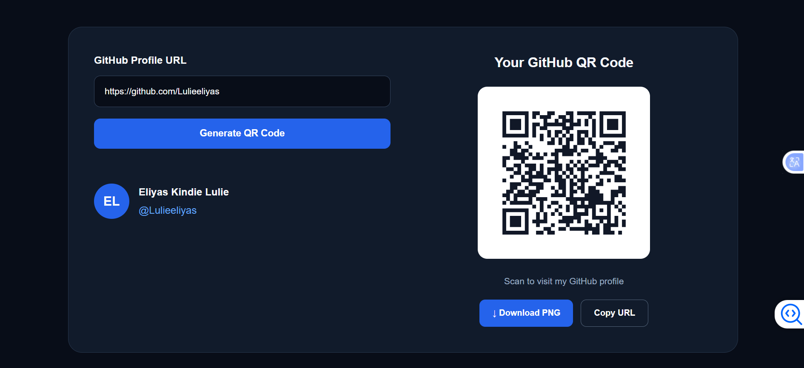

# 🚀 GitHub QR Code Generator

<p align="center">
  
  
  
  
</p>

<p align="center">
  <strong>A modern, responsive, and easy-to-use GitHub Profile QR Code Generator.</strong>
  <br/>
  Generate, download, and share your GitHub profile QR code in seconds.
</p>

---

## 🌟 About The Project

**GitHub QR Code Generator** is a modern web application built with React and TypeScript that allows developers to generate QR codes for their GitHub profiles.

Instead of manually sharing long profile URLs, users can generate a QR code that anyone can scan to visit their GitHub profile instantly.

The application features a clean, modern interface with a dark theme, responsive design, and simple QR code management.

### 🎯 Project Goals

- Make GitHub profiles easier to share.
- Help developers promote their GitHub portfolios.
- Provide instant QR code generation.
- Allow users to download QR codes as PNG images.
- Create a simple and responsive user experience.

---

## ✨ Features

| Feature | Description |
|---|---|
| 🔗 GitHub URL Input | Enter a GitHub profile URL |
| 📱 QR Generation | Generate QR codes instantly |
| 🖼️ PNG Download | Download QR codes as PNG images |
| 📋 Copy URL | Copy your GitHub profile link |
| 🎨 Modern UI | Attractive dark-themed interface |
| 📱 Responsive Design | Works on desktop, tablet, and mobile |
| ⚡ Fast Performance | Powered by Vite and React |
| 🔐 URL Validation | Validate GitHub profile URLs |

---

## 🖥️ Application Preview

> Add your application screenshots here after running the project.

<!-- Replace the image paths with your actual screenshots -->

<p align="center">
  
</p>

<p align="center">
  
</p>

<p align="center">
  <em>GitHub QR Code Generator – Homepage Preview</em>
</p>

---

## 🛠️ Technologies Used

### Frontend
- **React** – Building interactive user interfaces.
- **TypeScript** – Type-safe JavaScript development.
- **Vite** – Fast frontend development and build tool.
- **CSS3** – Responsive styling and modern UI design.

### QR Code Library
- **qrcode.react** – Generating QR codes in React applications.

### Development Tools
- Visual Studio Code
- Node.js
- npm
- Git and GitHub

---

## 📂 Project Structure

```text
github-qr-generator/
│
├── public/
│
├── src/
│   ├── App.tsx
│   ├── App.css
│   ├── index.css
│   └── main.tsx
│
├── index.html
├── package.json
├── package-lock.json
├── tsconfig.json
├── vite.config.ts
├── README.md
└── .gitignore
```

---

## ⚙️ Installation and Setup

Follow these instructions to run the project locally.

### 1. Prerequisites

Make sure you have installed:

- [Node.js](https://nodejs.org/)
- [Visual Studio Code](https://code.visualstudio.com/)
- npm (included with Node.js)

### 2. Clone the Repository

```bash
git clone https://github.com/Lulieeliyas/github-qr-generator.git
```

### 3. Navigate to the Project

```bash
cd github-qr-generator
```

### 4. Install Dependencies

```bash
npm install
```

### 5. Install QR Code Package

```bash
npm install qrcode.react
```

### 6. Start Development Server

```bash
npm run dev
```

Open the application in your browser:

```text
http://localhost:5173/
```

---

## 🚀 How to Use

1. Open the GitHub QR Code Generator.
2. Enter your GitHub profile URL.
3. Click **Generate QR Code**.
4. View your generated QR code.
5. Click **Download PNG** to save the image.
6. Scan the QR code using your smartphone camera.
7. Share your GitHub profile with others.

### Example GitHub Profile

```text
https://github.com/Lulieeliyas
```

---

## 📦 Production Build

To create an optimized production build, execute:

```bash
npm run build
```

To preview the production build locally:

```bash
npm run preview
```

The production files will be generated inside the `dist/` directory.

---

## 🌐 Deployment

You can deploy this application using:

- [Vercel](https://vercel.com/) – Recommended for Vite applications.
- [Netlify](https://www.netlify.com/) – Alternative frontend hosting.
- [GitHub Pages](https://pages.github.com/) – Static website hosting.

### Recommended: Vercel

1. Push your project to GitHub.
2. Open Vercel.
3. Import your GitHub repository.
4. Select Vite as the framework.
5. Set the build command to:

```bash
npm run build
```

6. Set the output directory to:

```text
dist
```

7. Click Deploy.

---

## 🔮 Future Improvements

The project can be extended with additional features:

- [ ] GitHub API integration to retrieve profile information.
- [ ] GitHub avatar and profile statistics.
- [ ] Custom QR code colors.
- [ ] Custom QR code size.
- [ ] Logo integration inside QR codes.
- [ ] SVG and PDF downloads.
- [ ] QR code history.
- [ ] Multiple social media QR codes.
- [ ] Light and dark themes.

---

## 👨‍💻 Developer

<p align="center">
  <strong>Eliyas Kindie Lulie</strong>
  <br/>
  Software Engineering | Full-Stack Developer
</p>

<p align="center">
  <a href="https://github.com/Lulieeliyas">
    
  </a>
</p>

**GitHub Profile:**  
https://github.com/Lulieeliyas

**Project Repository:**  
https://github.com/Lulieeliyas/github-qr-generator

---

## 🤝 Contributing

Contributions, suggestions, and improvements are welcome!

If you would like to contribute:

1. Fork the repository.
2. Create a new feature branch.
3. Make your changes.
4. Commit your changes.
5. Submit a pull request.

---

## 📄 License

This project is available under the MIT License.

You can add a `LICENSE` file to the repository when you choose to publish it under this license.

---

<p align="center">
  <strong>⭐ If you find this project useful, consider giving it a star on GitHub!</strong>
  <br/><br/>
  Made with ❤️ by <strong>Eliyas Kindie Lulie</strong>
  <br/>
  © 2026 GitHub QR Code Generator
</p>
